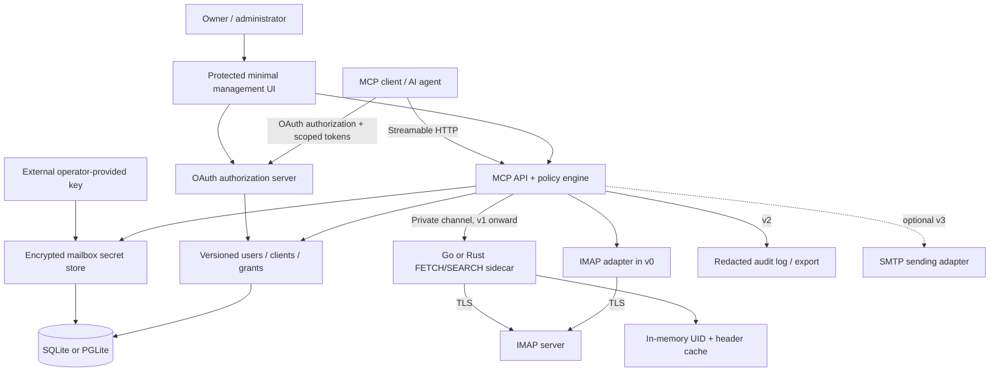

# Product Requirements Document: Self-hosted IMAP MCP Server

| Field | Value |
|---|---|
| Status | Draft — proposed requirements, not an implementation claim |
| Date | 2026-11-07 |
| Owner | Christian Zepter |
| Product | Self-hosted IMAP MCP Server (working name) |
| Delivery model | Open-source, self-hosted; single owner initially |
| Planning horizon | v0–v3; scope gates, not calendar commitments |
| Inputs | [Version plan](imap-mcp-version-plan.md); [Landscape research](imap-mcp-landscape.md), researched 2026-11-07 |

## 1. Problem statement

Self-hosters want AI agents to read, draft, and organize existing IMAP mailboxes without giving each agent unrestricted mailbox credentials. They need a remotely accessible MCP service, OAuth-based client authorization, an understandable mailbox setup flow, and permissions they can change after initial consent.

The product must separate mailbox authentication from agent authorization. An administrator should be able to grant an agent read access to one mailbox, allow another agent to draft or organize messages, and reduce or revoke those rights without changing the underlying IMAP password. Mailbox secrets must remain server-side and encrypted at rest.

The core opportunity is a small authorization-and-mail bridge, not another full email client.

## 2. Background and market context

The supplied landscape reviewed about 20 projects across GitHub, npm, PyPI, and the official MCP registry. Its findings are a dated research snapshot, not independent verification performed for this PRD.

| Closest reference | Findings in the supplied research | Product implication |
|---|---|---|
| [mkrasselt1/imap-mcp-server](https://github.com/mkrasselt1/imap-mcp-server) | TypeScript, SQLite, OAuth 2.1 authorization server, client registration, per-token scopes, mailbox dashboard, AES-256-GCM passwords; 0 stars, last commit 2026-04-27. Missing draft creation, editable post-consent grants, provider XOAUTH2, and audit log; OAuth tokens stored plaintext. MIT declared in README/package, but no detected LICENSE file. | Closest fork candidate, conditional on license clarification and security/code review. |
| [factorial-io/imap-mcp](https://github.com/factorial-io/imap-mcp) | MIT, Rust, OAuth server, external OIDC, multi-mailbox management, drafts, Redis; no per-client rights. 3 stars, last commit 2026-10-09. | Reference for Rust integration and mailbox management, not a complete permission solution. |
| [cldt-fr/imap-mcp](https://github.com/cldt-fr/imap-mcp) | MIT, OAuth 2.1, hashed tokens, encrypted credentials, account UI; depends on Clerk and Postgres, no per-client scopes. 4 stars, last commit 2026-04-30. | Reference for token handling; mandatory SaaS and heavier storage do not match the intended minimal deployment. |
| [Wh1isper/mcp-email-server](https://github.com/Wh1isper/mcp-email-server) | BSD-3, local stdio, account UI, SQLite configuration and OS keyring; no MCP client OAuth. 378 stars, last commit 2026-11-03. | Useful account and safety patterns, but not the target remote authorization model. |

The research found no project combining editable per-client/per-mailbox rights, remote OAuth, minimal UI, draft-only workflows, and the desired encrypted embedded storage/key lifecycle. It found no PGLite implementation in the reviewed set. These are scoped findings, not proof that no other project exists.

**License position:** Recommend MIT or Apache-2.0 for this product. Retain applicable notices and review dependencies. GPL/LGPL/AGPL code requires separate compatibility and obligation review; distribution and, for AGPL, network-use obligations can matter for a self-hosted product. Do not assume commercial or unlicensed code is reusable. In particular, the research lists submail as unlicensed despite a close feature set, and EmailEngine as commercially licensed. Confirm the closest candidate's actual license before copying or forking. This is a release due-diligence requirement, not legal advice.

**Build/buy decision:** Evaluate the closest permissive candidate before implementing from scratch. Prefer a clean implementation if the permission-first data model, embedded-store choice, or remediation cost makes adaptation less economical. The architectural requirements below apply either way.

## 3. Goals and success metrics

| Goal | Measure / release gate |
|---|---|
| Deliver useful delegated email access | v0 integration tests pass for search, read, draft, move, and flag operations against a documented IMAP fixture. |
| Keep control with the mailbox owner | v0 authorization matrix has zero unexpected allows; reductions affect the next call even with an existing token. v1 folder/operation and revocation tests also pass. |
| Keep secrets away from models and copied storage | No plaintext secrets in database/WAL dumps, API/tool responses, or logs; absent/wrong keys fail closed. |
| Handle everyday large mailboxes | v1 supports 5,000+ messages and meets the reproducible 10,000-message benchmark in Section 8. |
| Make access explainable and operations recoverable | v2 audit records cover every tested tool attempt; injected connection failures recover within the stated budgets without blind write replay. |
| Enable safe shared hosting and recovery | v3 tenant-isolation suite passes; a backup up to 1 GB restores on a clean host within 15 minutes. |

These are proposed engineering targets, not market-adoption claims. Run functional, authorization, migration, failure-injection, and benchmark suites before the corresponding release; publish fixture and environment details with results.

## 4. Non-goals

- Full webmail interface, general inbox replacement, calendar/contacts suite, or autonomous email classifier.
- HTTP Basic authentication or shared static API keys for MCP clients.
- Sharing IMAP credentials with clients or embedding them in model-visible tokens.
- SMTP sending before v3; sending remains optional even in v3.
- Permanent deletion/expunge exposed as an agent tool in the planned releases.
- Fine-grained folder rules or sidecar performance guarantees in v0.
- Universal provider OAuth support in v0; MCP OAuth does not imply Gmail/Microsoft upstream OAuth support.
- Persistent full-body indexing, distributed caches, or universal provider/body-search latency guarantees in v1.
- Multi-user tenancy before v3; shared/team mailboxes remain outside the initial v3 scope.
- High availability, cross-region service, compliance certification, or guaranteed exactly-once IMAP writes.

## 5. Target users and personas

| Persona | Need | Product experience |
|---|---|---|
| Self-hoster / mailbox owner | Connect existing mail without handing credentials to an AI provider; keep deployment and data under local control. | Install service, add/test mailbox, consent to a client, inspect/change grants. |
| MCP client / AI agent | Discover permitted tools, search/read messages, prepare drafts, and organize messages with predictable failures. | OAuth flow, bounded structured tool calls, stable message references; never receives mailbox secrets. |
| Administrator | Operate the service, restrict access, diagnose failures, recover encrypted data, and later manage multiple users. | Minimal protected management UI, grants, health information, v2 audit/export, v3 backup/restore and user isolation. |

In v0–v2, the owner and administrator may be the same person. An MCP client identity is not an administrator identity.

## 6. User stories and use cases

1. **Connect a mailbox:** As an owner, I enter IMAP connection details, test TLS connectivity, and save them so access survives a restart without displaying saved secrets.
2. **Authorize an agent:** As an owner, I approve a client's requested rights for a selected mailbox so unrelated clients and mailboxes remain inaccessible.
3. **Read safely:** As an agent, I search and retrieve an authorized message without marking it read unless a separate flag operation is authorized and requested.
4. **Draft without sending:** As an owner, I allow an assistant to prepare a draft in my Drafts folder while preventing SMTP transmission.
5. **Organize explicitly:** As an agent, I move selected messages or set/clear allowed flags; I cannot silently delete mail or choose unauthorized destinations.
6. **Change my mind:** As an owner, I reduce or revoke a grant and see the change enforced on subsequent calls without rotating mailbox credentials.
7. **Work with a large inbox:** As an owner, I use a mailbox with thousands of messages without repeated full metadata downloads after each new arrival.
8. **Investigate and recover:** As an administrator, I identify which client accessed which messages, recover from network drops, and later restore an encrypted installation without exposing the recovery key alongside the database.

## 7. Functional requirements

**Priority:** Must = required for its target release; Should = strongly desired but separately negotiable; Could = optional. A version indicates first required delivery; requirements carry forward. Explicit non-goals are Won't for the stated horizon or version.

| ID | Requirement | MoSCoW | Target |
|---|---|---|---|
| FR-01 | Expose MCP through Streamable HTTP; support initialization, tool discovery, and authenticated tool calls with documented schemas and structured errors. | Must | v0 |
| FR-02 | Provide an OAuth 2.1 authorization-server role for MCP clients: authorization code with PKCE, consent, discovery/resource metadata needed by supported clients, short-lived audience-bound access tokens, expiration, and revocation. Reject Basic auth and pre-shared static tokens. | Must | v0 |
| FR-03 | Permit controlled client registration and management. Explicitly document supported clients and whether registration is admin-provisioned or dynamic; registration alone grants no mail access. | Must | v0 |
| FR-04 | Provide a protected minimal UI to add/edit/remove mailbox configuration, test connection, select Drafts folder, and report actionable status without returning saved secrets. Removing configuration does not delete remote mail. | Must | v0 |
| FR-05 | Manage default-deny grants keyed by client and mailbox, using read/draft/organize presets; permit later reductions, revocation, and explicit owner-approved increases within the consent rules in Section 10. | Must | v0 |
| FR-06 | List authorized folders/messages, search using bounded IMAP-backed criteria, and retrieve headers/body through documented tools; paginate results and preserve unread state on reads. | Must | v0 |
| FR-07 | Create a draft using IMAP APPEND in the configured Drafts folder; return its stable reference when obtainable, or an explicit unresolved outcome. Never send it. | Must | v0 |
| FR-08 | Move a message only between authorized folders within the same mailbox; return the resulting reference when available. Do not expose permanent delete/expunge as a separate tool. | Must | v0 |
| FR-09 | Set/clear supported non-deletion flags. Define sort/organize as explicit move/flag actions, with a per-message outcome for batches; no automatic classifier is required. | Must | v0 |
| FR-10 | Store mailbox secrets encrypted in one selected embedded store, SQLite or PGLite, alongside versioned mailbox/client/grant records; support restart without secret re-entry. | Must | v0 |
| FR-11 | Validate TLS for upstream IMAP and separate upstream authentication from MCP OAuth. Start with documented compatible mailbox authentication; never fall back to unencrypted login. | Must | v0 |
| FR-12 | Add provider-side XOAUTH2 onboarding/refresh for explicitly selected providers; provider compatibility is not claimed until tested. Its scheduling is a proposal requiring scope confirmation. | Should | v1 |
| FR-13 | Refine grants by folder and operation, with explicit deny precedence, client revocation, and safe migration of existing coarse grants without privilege expansion. | Must | v1 |
| FR-14 | Use a Go or Rust sidecar for IMAP FETCH/SEARCH with an in-memory UID/header cache and a local or authenticated private boundary. | Must | v1 |
| FR-15 | Implement UIDVALIDITY-aware incremental synchronization using UIDNEXT for arrivals and separate UID/flag reconciliation for expunges and changes. | Must | v1 |
| FR-16 | Add CONDSTORE/QRESYNC acceleration where supported, without making it necessary for correctness. | Could | v1 |
| FR-17 | Handle provider errors, timeouts, IDLE drops, and reconnection using bounded backoff; distinguish safe read retries from ambiguous mutations. | Must | v2 |
| FR-18 | Record/export access audit events identifying client, mailbox, folder/message references, tool, timestamp, request ID, and outcome; cover successful, denied, failed, and cached calls. | Must | v2 |
| FR-19 | Document installation, OAuth setup, TLS, key provisioning, upgrades, migrations, health checks, troubleshooting, and operational recovery. Minimal secure setup instructions must already ship with v0. | Must | v2 |
| FR-20 | Add users, ownership, and per-user resource/connection limits; isolate mailbox data, grants, caches, credentials, and audits by owner. | Must | v3 |
| FR-21 | Back up and restore consistent encrypted database state with separate key recovery, tested key rotation, corruption detection, and post-restore reauthorization. | Must | v3 |
| FR-22 | Possibly send via SMTP using a distinct send capability and explicit approval bound to exact recipient/content/attachments; disabled by default and never implied by draft rights. | Could | v3 |

### Tool contract and completion rules

- Exact tool names are implementation choices; schemas must distinguish search, read, draft, move, and flag. Separate metadata/header retrieval from body retrieval where needed for v1 rights.
- Message identity is mailbox + folder + UIDVALIDITY + UID, not a transient sequence number or globally unique Message-ID header. Invalidated references return an explicit stale-reference error.
- Validate inputs, authorize all source/destination resources, and cap result counts before fetching or returning data. Document configured bounds; do not silently truncate a result without pagination information.
- Search counts, snippets, folder listings, caches, and error messages must not leak unauthorized content. No write grant implicitly permits body reading.
- Reads use non-mutating fetch behavior. Draft uses APPEND, not SMTP. Moves must not expunge unrelated messages; providers without a safe implementation return unsupported-operation.
- Flag writes exclude deletion flags. Batch calls report partial completion instead of claiming atomicity across IMAP operations.
- Grant changes are checked on every tool call; pending writes recheck immediately before execution where possible. A write already accepted by the upstream server cannot be recalled by revocation.

## 8. Non-functional requirements

### Security, encryption, and keys

- **NFR-S1 — v0:** Enforce authorization server-side, default deny, and protect the management UI independently of MCP authorization. Require authenticated administration, CSRF protection for browser state changes, secure cookies, validated redirects, PKCE, and bounded login/token attempts. No publicly writable setup endpoint after bootstrap.
- **NFR-S2 — v0:** Validate access-token issuer, audience/resource, expiry, and integrity; bind sessions to the authenticated client. Store opaque bearer-token verifiers as hashes, not plaintext; encrypt refresh material if it must be retrievable. Never log bearer tokens, authorization codes, or mailbox credentials.
- **NFR-S3 — v0:** Use authenticated encryption for mailbox secrets, including provider refresh tokens when supported. Keep the master key outside database/backups in an operator-provided secret mount. Missing/wrong keys fail closed. Select and document the scheme and key version metadata before implementation.
- **NFR-S4 — v0:** Model copied-database protection, not protection against a compromised running host. Mail content is untrusted input, not authority to broaden permissions, reveal credentials, or trigger unrelated actions.
- **NFR-S5 — v0:** Mailbox connection testing must not become unrestricted server-side network access. Validate destinations and configure host/network policy; explicitly approved private-network mail servers may be supported without opening arbitrary internal endpoints.
- **NFR-S6 — v1/v3:** Protect the sidecar channel and restrict secret delivery to the intended mailbox operation. Add user isolation in v3. Rotation must survive interruption; older backup key dependencies must be documented.

### Performance and synchronization

All budgets are proposed release gates under documented conditions, not promises across arbitrary providers.

| Gate | Target and conditions |
|---|---|
| v1 fixture | 10,000 messages; 2 KB average cached headers; 2 vCPU/2 GB RAM; IMAP RTT ≤20 ms. Tests also cover 5,000-message mailboxes. |
| Cold metadata sync | ≤30 seconds for UID/header cache population. |
| Warm metadata list/search | p95 ≤300 ms across 100 calls, concurrency 5, returning at most 100 results per call. Body transfer and remote body search measured separately. |
| Sidecar memory | RSS <256 MB on the v1 fixture. |
| New arrivals | 100 added messages searchable ≤5 seconds after sync starts, without full re-FETCH of unchanged messages. |
| Flag/expunge detection | Reconcile within 60 seconds; a UIDVALIDITY reset rebuilds within the cold-sync budget and cannot serve old mappings. |
| v3 load | 10 users × one 5,000-message mailbox; 4 vCPU/8 GB RAM; 60-minute mixed read/search/flag run at aggregate concurrency 20; <1% unexpected errors, warm metadata p95 <1 second. |

### Reliability and operations

- **NFR-R1 — v2:** Upstream tool requests terminate within 30 seconds unless explicitly running a longer sync job; failures produce structured, redacted errors rather than process crashes.
- **NFR-R2 — v2:** Reconnect with jittered exponential backoff, initially 1 second and capped at 60 seconds. Resume within 90 seconds after connectivity returns, renew IDLE before provider deadlines, and reconcile missed changes. Authentication failures stop credential retry loops.
- **NFR-R3 — v2:** Never blindly replay ambiguous APPEND/move/flag writes. Reconcile state or return an unknown-outcome error; do not promise exactly-once execution.
- **NFR-R4 — v3:** Restore a consistent database up to 1 GB within 15 minutes on the documented clean-host fixture. Wrong keys/corruption fail explicitly; restore invalidates earlier sessions/tokens or enforces an equivalent reauthorization boundary.

### Privacy, maintainability, and licensing

- Cache UIDs and headers in memory in v1; do not persist message bodies or create a full mailbox mirror by default. Bodies may exist transiently during authorized fetches.
- v2 audit logs include exact returned UID sets for multi-message reads/searches, not bodies, header text, or credentials. Configure retention/export; treat message identifiers and access history as sensitive data. Record timestamps unambiguously and label the local zone in human-facing displays.
- No mandatory external SaaS identity provider, telemetry service, or cloud database for core self-hosting. The v0 administrator-authentication choice remains a blocking design decision.
- Version schemas and tool contracts. Migration tests must prove effective rights do not broaden. Maintain a documented compatible IMAP-provider matrix rather than claiming universal compatibility.
- Recommend MIT or Apache-2.0; require license inventory, notices, and dependency compatibility review before release. Resolve any missing license before reusing reference code.

## 9. Architecture overview

**Trust boundaries:** The MCP API validates client identity and current policy before data access. The OAuth server authenticates clients/consent but never treats a token as a replacement for current grant checks. The UI is an administrative surface, not a mailbox-secret echo service. Only trusted server components receive decrypted upstream credentials. The sidecar is not a second publicly accessible mail API.

**Logical data model:** Owner/user; OAuth client; mailbox; folder reference; grant and policy version; encrypted credential record with key version; OAuth token/session verifier; audit event. Introduce tenant ownership explicitly in v3, with a migration from the initial owner. Cache keys must include owner when multi-user support arrives.

**Deployment:** Single self-hosted installation with an embedded database and TLS termination. v0 may run IMAP directly in the main service. v1 moves FETCH/SEARCH to a Go/Rust sidecar without moving authorization responsibility; placement of mutation execution is an implementation decision. v2 adds operational maturity; v3 adds tenancy and consistent encrypted backup/restore.

## 10. Permission model specification

### v0: “grob gehalten” (coarse-grained)

A grant is identified by `(client_id, mailbox_id, capability)` under the initial owner. No grant exists by default. Capabilities are independent:

| Capability | Permits | Does not imply |
|---|---|---|
| `read` | List permitted mailbox folders/messages, search, read headers/body. | Drafting, flag writes, moving, sending. |
| `draft` | Append new drafts to the explicitly configured Drafts folder. | Reading existing messages/drafts, moving, flagging, sending. |
| `organize` | Explicit move and permitted flag operations within the granted mailbox. | Reading body/header content, drafting, sending, deletion. |

A permitted write may return minimal identifiers/status necessary to confirm it; this is not a general read entitlement. A client without read access must receive message/folder references through an authorized workflow rather than gaining discovery access automatically. Cross-mailbox moves are out of scope; both source and destination must satisfy the applicable organize policy.

**Token and consent boundary:** Use mailbox-independent capability labels plus server-side mailbox grants, or an equivalent documented representation. Effective access is the intersection of the token's authorized capability ceiling, the current owner-approved client/mailbox grant, and the requested operation/resources. An admin reduction/removal applies on the next call, including old tokens. Increasing beyond the recorded consent ceiling requires explicit renewed owner consent and a newly authorized token; never silently expand an existing token. Editable grants do not mean bypassing consent.

**Management:** Show clients, granted mailboxes, capabilities, and revocation state. Persist edits atomically and invalidate relevant policy caches. UI edits manage policy only, never mutate mail implicitly.

### v1: refined rights

- Add folder selectors and separate `search`, `read_headers`, `read_body`, `draft`, `move`, and `flag` operations; optionally constrain flag names and move destinations.
- Explicit deny overrides allow. No matching allow means deny. Search results/counts/snippets and cache responses are subject to the same policy.
- A move checks source authorization and destination authorization separately. Resolve folder references consistently across renames; invalid selectors fail closed until corrected.
- Revoke a client or its grants without changing IMAP credentials. Block new calls within 5 seconds; v0's stricter next-call rule for grant reductions still applies. Recheck pending writes before execution; do not claim cancellation of completed upstream writes.
- Migrate v0 presets to equivalent folder/operation rights. Preserve any authorized folder-discovery behavior explicitly rather than introducing broader permissions as a side effect.

### v3: ownership and optional sending

Attach users to clients, mailboxes, policy, cache keys, and audit access. Require ownership before evaluating resource grants; guessing another user's identifier never confers access. If SMTP ships, add independent `send` authorization and a one-use explicit approval bound to the exact message payload. Any recipient/content/attachment change invalidates approval. Do not infer approval from email content or draft permission.

## 11. Release plan and exit criteria

| Version | Product outcome | Exit criteria summary | Deliberately deferred |
|---|---|---|---|
| **v0 — “grob gehalten”** | Minimal useful, secure single-owner mail delegation. | OAuth/Streamable HTTP interoperability; onboarding/restart; encrypted-secret tests; default-deny editable grants; all five core tool paths pass. | Fine rules, sidecar, performance SLA, multi-user, SMTP. |
| **v1 — Precision and performance** | Fine rights and responsive 5,000+ message mailboxes. | Folder/operation/revocation matrix; protected Go/Rust sidecar; UIDVALIDITY/UIDNEXT/expunge tests; all v1 performance budgets pass. | Distributed cache, body index, mandatory CONDSTORE/QRESYNC. |
| **v2 — Production hardening** | Operable, resilient, inspectable self-hosting. | Failure injection; backoff/IDLE recovery; ambiguous-write safety; complete tested audits; clean-host documentation walkthrough. | HA, multi-region, certification, tenancy. |
| **v3 — Ecosystem and scale** | Isolated users and recoverable encrypted deployments. | Tenant isolation and load gate; clean-host restore and rotation; post-restore authorization reset. SMTP gate only if selected. | Full webmail, shared mailboxes, Internet-scale hosted service; SMTP may remain unsupported. |

Each release inherits previous security and functional gates. The detailed [version plan](imap-mcp-version-plan.md) supplies the per-version acceptance checklist; this PRD adds product context, requirements, boundaries, and decision points. A failing security gate blocks release rather than becoming a stretch item.

## 12. Risks and mitigations

| Risk | Impact | Mitigation / validation |
|---|---|---|
| Reusing unclear or incompatible licenses | Blocks redistribution or changes obligations. | Verify actual license text and dependency tree before reuse; keep notices; select clean implementation if unresolved. |
| Prototype reference lacks security maturity | Inherited OAuth, token, or encryption defects. | Treat research fit as a starting point, not endorsement; review auth/key handling and run threat-model-driven tests before exposing the service. |
| Grant editing contradicts token consent | Silent privilege escalation or ineffective revocation. | Intersect token ceiling and live grants; require renewed consent for expanded ceiling; test existing-token behavior. |
| Key loss or key copied with backups | Unrecoverable secrets or ineffective at-rest protection. | External key mount, separate recovery package, tested restores/rotation, explicit threat model. |
| Provider differences and IMAP identity changes | Stale references, incorrect moves, missed updates. | UIDVALIDITY keys, UID/flag reconciliation, capability tests, supported-provider matrix, safe unsupported errors. |
| Ambiguous network failures during writes | Duplicate drafts or unintended mutations. | No blind replay; reconciliation/unknown outcome; document non-exactly-once boundary. |
| Header cache crosses a policy/tenant boundary | Unauthorized disclosure. | Authorization before cache access/return; owner-aware keys; isolation and policy-change tests. |
| Email prompt injection or unsafe host input | Unapproved operations or internal-network access. | Treat mail as untrusted; enforce tools server-side; explicit send approval; destination policy for mailbox connections. |
| Performance targets overfit one server | Poor experience elsewhere. | Publish benchmark conditions and separate local metadata from provider body-search costs; test representative servers. |
| Overloaded scope | Minimal bridge becomes a mail suite. | Freeze v0 coarse scope; optional SMTP and QRESYNC stay optional; use release gates rather than feature accumulation. |

## 13. Open questions and required decisions

### Blocking v0 implementation/release

1. **Reuse or clean implementation?** Verify mkrasselt1 licensing and review its security/data model; compare remediation effort with a new permission-first implementation.
2. **SQLite or PGLite?** Select one, including migration, WAL/backup implications, packaging, and runtime support; do not require both.
3. **Project license?** Confirm MIT versus Apache-2.0 and compatible dependencies before publishing.
4. **Administrator authentication/bootstrap?** Choose a self-hostable method and secure first-run ownership flow without adding mandatory SaaS.
5. **OAuth interoperability scope?** Name supported MCP clients, registration model, consent UX, token lifetimes/refresh policy, and supported protocol revision; test them rather than assuming all clients interoperate.
6. **Encryption design?** Choose authenticated-encryption/envelope scheme, key provisioning format, token-verifier storage, and recovery documentation; database-column encryption versus whole-database protection must be explicit.
7. **Initial IMAP support?** Name tested servers/providers, auth modes, safe move behavior, Drafts discovery/selection, supported flags, and batch/result limits.

### Before v1

8. **Go or Rust?** Choose sidecar language, IPC contract, credential delivery, lifecycle, and which component executes writes.
9. **Fine policy semantics?** Finalize folder identity/rename rules, selectors, deny precedence UI, and exact migration mappings.
10. **Provider XOAUTH2 priority?** Confirm the proposed Should/v1 requirement and first providers, or explicitly defer it; do not conflate this with mandatory MCP OAuth.
11. **Benchmark implementation?** Fix server fixture, message/header distributions, sync start triggers, and search predicates; targets cannot be validated without a repeatable harness.

### Before v2/v3

12. **Audit durability/retention?** Decide retention defaults, disk-full behavior, export format, and whether audit-write failures block accesses; document privacy tradeoffs.
13. **Multi-user identity and admin powers?** Choose local/external identity options, owner migration, and whether administrators can access content or only operate infrastructure.
14. **Recovery objectives?** Confirm backup schedule/RPO and key escrow responsibilities; only restore-time/RTO is currently specified.
15. **SMTP go/no-go?** Validate demand, approval UX, recipient restrictions, provider support, and retry semantics before enabling; omission is a valid v3 decision.

## 14. Approval and validation

This draft requires owner approval of scope and the blocking decisions above. Engineering should map each FR/NFR to automated tests or a documented manual acceptance procedure before implementation is considered complete. Landscape facts remain attributed to the supplied research snapshot; architectural choices and budgets in this PRD are proposed product requirements.
